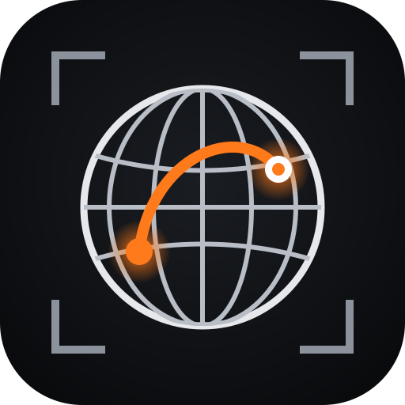
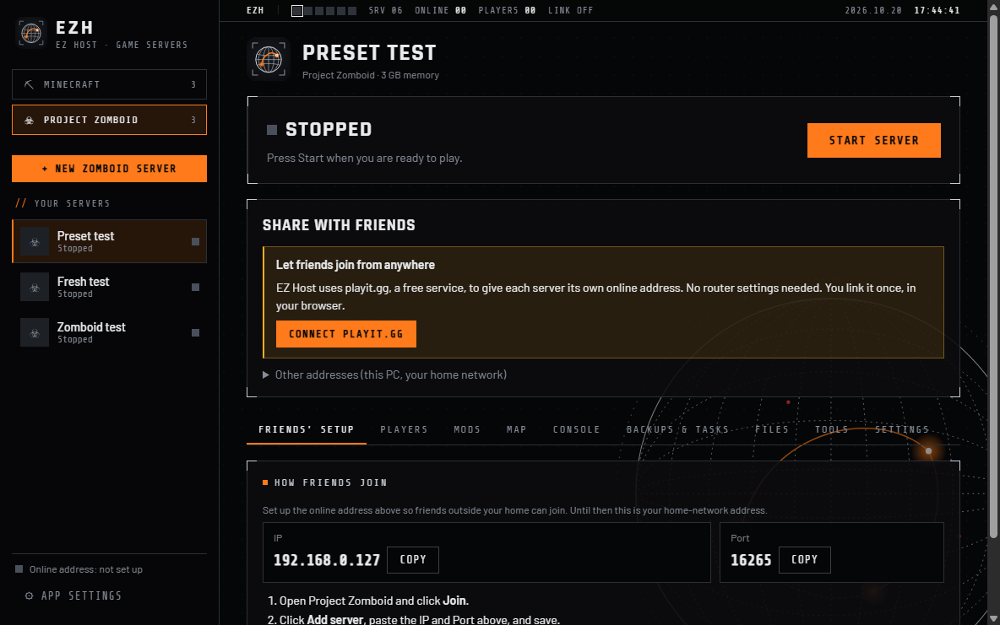
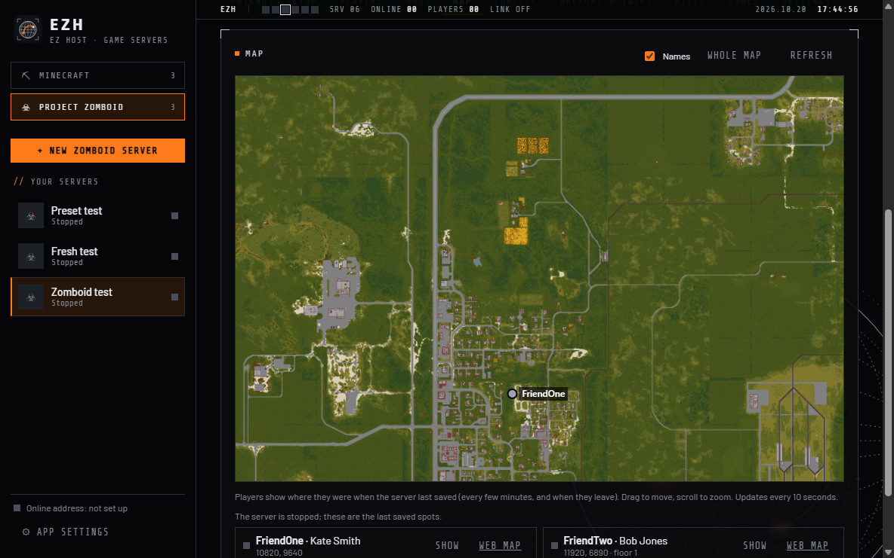
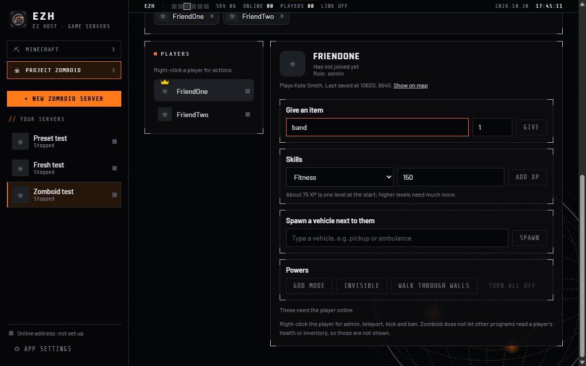
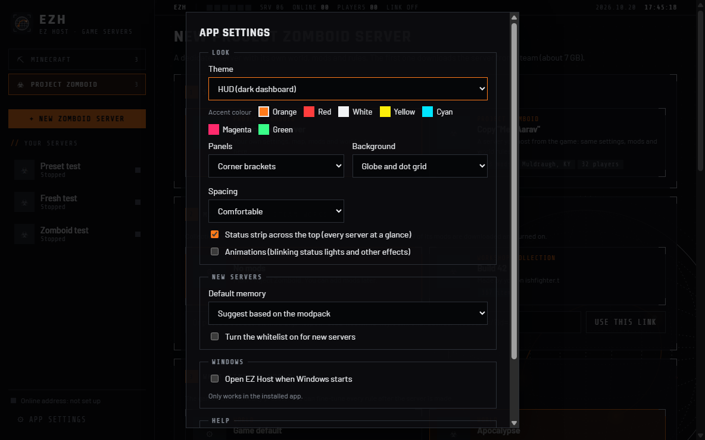

<p align="center">
  
</p>

<h1 align="center">EZ Host</h1>

<p align="center">
  <b>Host Minecraft and Project Zomboid servers on your own PC, so friends can join from anywhere.</b><br />
  Free. No commands, no router settings, no monthly server bill.
</p>

<p align="center">
  <a href="https://github.com/Ish-2601/Self-Host-MC/releases/latest"></a>
</p>

<p align="center">
  
</p>

---

## Download and install

1. Open the **[latest release](https://github.com/Ish-2601/Self-Host-MC/releases/latest)**.
2. Download **`EZ-Host-Setup-<version>.exe`**, the first file in the list.
3. Double-click it and follow the steps. EZ Host gets a desktop shortcut and a Start menu entry.

That's it. Java, mod loaders, the Zomboid dedicated server and everything else download by themselves the first time you need them.

> **"Windows protected your PC"?** Windows shows this for any new app that doesn't have a paid code-signing certificate yet, and EZ Host is free and open source, so it doesn't. It doesn't mean something is wrong. Click **More info**, then **Run anyway**.
>
> Want to check the file first? The release lists a SHA-256 checksum for each download. In PowerShell, run `Get-FileHash EZ-Host-Setup-<version>.exe` and compare it with the release page. All of the code is in this repo, and you can build the installer yourself (see [Build from source](#build-from-source)).

The release also has an **`EZ-Host-portable-<version>.zip`**. Unzip it anywhere and run `EZ Host.exe` if you'd rather not install anything.

## Quick start

1. Pick a game in the sidebar: **Minecraft** or **Project Zomboid**.
2. Click **+ New server** and choose what to play:
   - **Minecraft:** a CurseForge, Modrinth App or Prism profile you already play (the server matches your game), any Modrinth modpack, a `.mrpack` file, or plain Minecraft.
   - **Project Zomboid:** a brand-new world with one of the game's presets, a copy of a server you host in-game, and your Steam Workshop collections.
3. Press **Start server**.
4. Click **Connect playit.gg** once (free) to get an online address. Send it to your friends and they join from anywhere.

## Supported games

| Game | What you get |
|---|---|
| **Minecraft: Java Edition** | Fabric, Forge, NeoForge, Quilt, Paper and vanilla. Modrinth modpacks, `.mrpack` files and your launcher profiles, with client-only mods left out automatically. Whitelist, OP, player inventories, a live world map with chunk force-loading, world pregeneration, backups and schedules. |
| **Project Zomboid** (Build 42) | A dedicated server installed through Steam (no login needed). World presets, every server option and world rule (including the ones your mods add), Steam Workshop mods and collections, whitelist accounts, an in-game map with players, item and vehicle spawning, skill XP and admin powers. |

## Features

- **One app for every server.** Each game has its own section, with its own servers, settings and tools.
- **Friends join from anywhere.** Every server gets its own online address through [playit.gg](https://playit.gg). There's no port forwarding, and the app shows friends exactly what to type.
- **Mods without the headache.** Turn mods on and off and see conflicts and missing requirements. Bad mods are switched off automatically if a server crashes.
- **Players at a glance.** See who's online, where they are on the map, and edit them: give items (type any part of a name), heal, teleport, ban and more.
- **It tells you what's wrong.** Startup progress, plain-language errors, and automatic retries for things like Steam hiccups.
- **Backups and schedules.** Restore points, scheduled restarts with in-game warnings, and an automatic restart when a Zomboid Workshop mod updates.
- **Make it yours.** Choose the HUD, Neon or Classic theme, then pick the accent colour, panel style, background, spacing and status strip.

<p align="center">
  
  
</p>
<p align="center">
  
</p>

## FAQ

**Is it really free?**
Yes. EZ Host is free and open source. playit.gg's free plan gives every server an address. Your friends still need to own the game.

**Does my PC need to stay on?**
Yes. The server runs on your PC, so friends can play while EZ Host is open and the server is started.

**Where are my servers stored?**
In `%APPDATA%\self-host-mc\data`. Uninstalling keeps them. The folder kept the app's old name so nothing was lost when it was renamed to EZ Host.

**How much memory should I give a server?**
EZ Host suggests an amount based on how many mods and players you have. A few mods need about 4 GB; big modpacks or Zomboid with hundreds of mods need 8 to 12 GB.

**My friend can't connect.**
Open the server's **Friends' setup** tab. It shows the exact address and port, the game version and the mods they need. For Minecraft, it can also check their CurseForge or Prism profile against the server.

**Zomboid says playit.gg needs a verified email.**
playit.gg only gives UDP addresses (which Zomboid uses) to accounts with a verified email. Verify it on playit.gg, then press Try again.

## Build from source

You need Node.js 20+ on Windows. Everything lives in the `data` folder.

```bash
cd data
npm install
npm start
```

To build the installer (`data/dist/EZ-Host-Setup-<version>.exe`):

```bash
npm run dist
```

The server engine has no Electron dependency, so you can smoke-test it from the command line:

```bash
npm run test:engine
```

| Folder | What's in it |
|---|---|
| `src/engine/` | The server engine (plain Node): Minecraft installs, Java, mod loaders, processes, RCON, playit.gg, backups |
| `src/games/zomboid/` | Project Zomboid: SteamCMD, server runner, settings, Workshop, map |
| `src/main/` | Electron main process and the preload bridge |
| `src/renderer/` | The UI (plain HTML, CSS and JS). The look is described in [DESIGN.md](../data/DESIGN.md) |
| `scripts/` | Smoke tests and the icon renderer |

See [ROADMAP.md](../data/ROADMAP.md) for what comes next.

## Code signing policy

Windows shows a warning for installers without a code-signing certificate. EZ Host is applying for free code signing for open-source projects from [SignPath.io](https://signpath.io), with the certificate provided by the [SignPath Foundation](https://signpath.org). Until that is approved, the installer is unsigned, and every release lists SHA-256 checksums so you can check your download.

- **How releases are built:** the installer is built by the [GitHub Actions workflow](workflows/build.yml) in this repository, straight from the source code here.
- **Who can approve a signing:** only the project owner, [@Ish-2601](https://github.com/Ish-2601).
- **Privacy:** see the [privacy policy](PRIVACY.md). EZ Host sends no data to the maintainer.

## Licence and credits

- EZ Host is released under the [MIT licence](../data/LICENSE).
- The logo and themes are original artwork for this app. The bundled fonts (Rajdhani, Barlow, Share Tech Mono) are under the SIL Open Font License; see `data/src/renderer/fonts/OFL-*.txt`.
- Minecraft servers require you to accept the [Minecraft EULA](https://aka.ms/MinecraftEULA). The app asks before a server's first start.
- EZ Host isn't affiliated with Mojang, Microsoft, The Indie Stone, Valve or playit.gg. Minecraft and Project Zomboid are trademarks of their owners.
